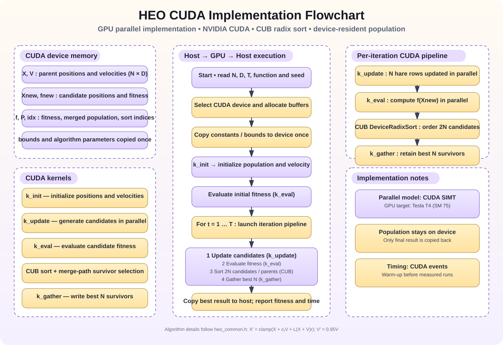
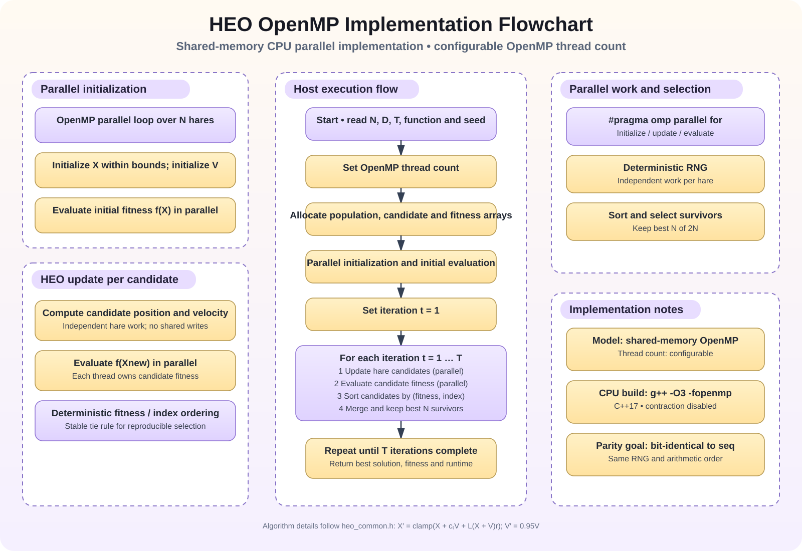

# Hare Escape Optimization (HEO): Sequential, OpenMP and CUDA

<p align="center">
  
  
  
  
  
</p>

<p align="center">
  <b>One optimization algorithm. Three execution back-ends.</b><br/>
  Sequential CPU · Shared-memory OpenMP · CUDA GPU
</p>

A reproducible C++17 implementation and performance study of the **Hare Escape Optimization (HEO)** metaheuristic. The final implementation, benchmark notebook, CSV data and experimental report are maintained in **[`heoimprved/`](./heoimprved/)**.

This README documents that final implementation only. The older root-level implementation and its scripts are not part of the documented workflow.

## Project overview

HEO is a population-based, single-objective minimization algorithm inspired by the escape behaviour of hares. A population of (N) hares maintains position and velocity vectors of dimension (D). At each iteration, every hare generates a candidate, candidates are evaluated, and elitist selection retains the best (N) individuals from the combined parent and candidate populations.

The final project provides three back-ends:

| Back-end | Source | Execution model |
|---|---|---|
| Sequential CPU | `heo_seq.cpp` | Single-threaded reference implementation |
| OpenMP CPU | `heo_omp.cpp` | Shared-memory parallel updates, evaluation, sorting and survivor selection |
| CUDA GPU | `heo_cuda.cu` | GPU kernels for initialization, updates, evaluation, selection and gathering |

All three implementations share `heo_common.h` and `heo_main.h`. This keeps the algorithm, random-number generation, benchmark functions, command-line interface and CSV format consistent across back-ends.

## Final project structure

```text
Hare-escape-optimization-algorithm-parallel-version/
├── heoimprved/
│   ├── heo_common.h
│   ├── heo_main.h
│   ├── heo_seq.cpp
│   ├── heo_omp.cpp
│   ├── heo_cuda.cu
│   ├── HEO_Sequential_OpenMP_CUDA_Comparison_improved.ipynb
│   ├── heo_report.md
│   └── csv/
│       ├── heo_parity.csv
│       ├── heo_speedup.csv
│       ├── heo_pop_sweep.csv
│       ├── heo_dim_sweep.csv
│       ├── heo_strong_scaling.csv
│       ├── heo_weak_scaling.csv
│       └── heo_hist_*.csv
└── README.md
```

The notebook also generates comparison and scaling figures when its analysis cells are run. The CSV directory contains recorded benchmark and analysis outputs; rerunning the notebook can regenerate the experiment outputs.

## Architecture and implementation flowcharts

The diagrams below give a visual overview of how the two parallel back-ends execute HEO. They are stored as scalable SVG graphics in `docs/images/`, so they remain sharp when viewed on GitHub or in a browser.

### CUDA GPU implementation



The CUDA workflow keeps the population and intermediate arrays on the GPU across iterations. Each iteration updates candidates, evaluates fitness, orders the combined population using CUB radix sort, and gathers the best (N) survivors. Only the final result is copied back to the host.

### OpenMP CPU implementation



The OpenMP workflow parallelizes independent hare initialization, candidate updates and fitness evaluation across CPU threads. Selection then retains the best (N) individuals from the parent and candidate populations.

> **Implementation note:** These are documentation diagrams illustrating the project’s high-level execution model. For exact kernel names, data structures, sorting details, RNG behaviour and selection semantics, refer to the source files in `heoimprved/`.

---

## Algorithm details

For each hare and each dimension, the candidate position follows the update structure:

[
X' = \operatorname{clamp}\left(X + c_t V + L(X+V)r,\; lo,\; hi\right)
]

The velocity is damped:

[
V' = 0.95V
]

The final implementation makes the paper-to-code decisions explicit in comments in `heo_common.h`. The default settings used for the reported experiment are:

| Parameter | Setting |
|---|---:|
| Velocity-reduction coefficient | 1.0 |
| Velocity damping | 0.95 |
| Lévy-flight exponent (β) | 1.5 |
| Lévy scale | 1.0 |
| Default position coefficient | ((T-t+1)/T) |
| Boundary handling | Clamp position to function bounds |
| Survivor selection | Merge parents and candidates; retain best (N) |
| Tie handling | Parents win ties |

**Important algorithm interpretation:** the default coefficient ((T-t+1)/T) is a documented interpretation intended to decrease over time. The literal coefficient (T/t), as printed in the paper's equation, is also available through `--scale literal`. The reported final experiment used the default `decay` mode, not the literal mode. Other under-specified details and benchmark-formula corrections are documented as A1–A9 in `heo_common.h`.

### Reproducibility and selection

The implementations use a stateless, counter-based SplitMix64 random-number generator. Each random value is determined by the seed, iteration, hare, dimension and stream, so it does not depend on thread scheduling.

- Sequential and OpenMP use the same arithmetic and are expected to produce bit-identical results.
- CUDA uses device math functions that can differ from host math libraries at floating-point rounding level.
- Candidate sorting uses a deterministic fitness/index order.
- Selection merges the sorted parent and candidate populations and keeps the best (N), with parents winning ties.

## Benchmark functions

The final implementation includes **14 benchmark functions**:

- **Scalable functions:** Step Sphere (F16), Quartic (F17), Schwefel (F18), Rastrigin (F19), Ackley, Griewank and Rosenbrock.
- **Two-dimensional functions:** Bohachevsky (F24), Booth (F25), Matyas (F26), Easom (F27), Beale (F28), Schaffer N.2 (F29) and Six-Hump Camel (F30).

The F24–F30 functions are fixed at dimension 2. F17 Quartic includes random noise in its objective evaluation. The implementation supports shifted-optimum experiments for the functions marked as shiftable in `heo_common.h`.

The project does **not** claim to reproduce the paper's full CEC 2015 shifted/rotated benchmark suite, its 29-competitor comparison, or its engineering-design experiments.

## Requirements

### CPU builds

- Linux environment recommended for the tested workflow.
- C++17-compatible `g++`.
- GNU libstdc++ parallel algorithms.
- OpenMP support (`-fopenmp`) for the OpenMP executable.

On Ubuntu/Debian, the CPU compiler and OpenMP runtime can be installed with:

```bash
sudo apt update
sudo apt install -y g++ libgomp1
```

### CUDA build

- NVIDIA GPU and compatible driver.
- NVIDIA CUDA Toolkit with `nvcc`.
- CUDA-compatible GPU architecture.
- CUB headers supplied with the CUDA Toolkit.

### Notebook and analysis

The notebook uses Python 3, NumPy, Pandas, Matplotlib and SciPy, and is designed for Google Colab. The recorded final report was produced in a Linux/Colab-style environment. A GPU runtime is required for the complete three-back-end experiment; the notebook can be configured to continue with CPU-only runs by setting `REQUIRE_GPU = False` in its GPU-validation cell.

## Get the project

Clone the repository and enter the final implementation directory:

```bash
git clone https://github.com/AdityaVerma126/Hare-escape-optimization-algorithm-parallel-version.git
cd Hare-escape-optimization-algorithm-parallel-version/heoimprved
```

## Compile the implementations

Build the sequential reference:

```bash
g++ -O3 -std=c++17 -ffp-contract=off heo_seq.cpp -o heo_seq
```

Build the OpenMP version:

```bash
g++ -O3 -std=c++17 -ffp-contract=off -fopenmp heo_omp.cpp -o heo_omp
```

Build the CUDA version. Replace `sm_75` with the compute capability of your GPU:

```bash
nvcc -O3 -std=c++17 -arch=sm_75 --fmad=false heo_cuda.cu -o heo_cuda
```

The `-ffp-contract=off` and `--fmad=false` flags avoid fused multiply-add contraction in the CPU and CUDA builds, respectively, helping preserve numerical comparability. Avoid `-ffast-math` and `--use_fast_math` for parity experiments because they can change floating-point evaluation.

## Run an implementation

All three executables share the same command-line interface. Example: run all supported functions with dimension 30, population 256, 200 iterations, 20 independent runs and base seed 42.

Sequential:

```bash
./heo_seq --func all --dim 30 --pop 256 --iters 200 --runs 20 --seed 42
```

OpenMP (set the desired thread count):

```bash
./heo_omp --func all --dim 30 --pop 256 --iters 200 --runs 20 --seed 42 --threads 8
```

CUDA:

```bash
./heo_cuda --func all --dim 30 --pop 256 --iters 200 --runs 20 --seed 42
```

The executables write benchmark rows as CSV to standard output and diagnostics to standard error. To save output:

```bash
./heo_seq --func F19 --dim 30 --pop 256 --iters 200 --runs 20 --seed 42 > seq.csv
OMP_NUM_THREADS=8 ./heo_omp --func F19 --dim 30 --pop 256 --iters 200 --runs 20 --seed 42 > omp.csv
./heo_cuda --func F19 --dim 30 --pop 256 --iters 200 --runs 20 --seed 42 > cuda.csv
```

### Useful command-line options

| Option | Description |
|---|---|
| `--func <id\|name\|all>` | Select a function by numeric ID, full name, short tag (such as `F19`) or all functions |
| `--dim D` | Problem dimension |
| `--pop N` | Population size |
| `--iters T` | Number of iterations |
| `--runs R` | Number of independent runs |
| `--seed S` | Base random seed |
| `--threads K` | OpenMP thread count; ignored by sequential and CUDA |
| `--shift` | Shift the optimum for supported functions |
| `--scale decay\|literal` | Select decreasing default coefficient or literal paper coefficient (T/t) |
| `--levy-scale s` | Scale the Lévy step |
| `--block B` | CUDA threads per block; multiple of 32 in [32, 1024] |
| `--history <file>` | Write best-so-far convergence history for run 0 using an additional untimed run |
| `--list` | Print benchmark function metadata |
| `--selftest` | Run built-in checks |
| `--help` | Print command-line usage |

Run the built-in checks after compiling:

```bash
./heo_seq --selftest
./heo_omp --selftest
./heo_cuda --selftest
```

### CUDA fitness-evaluation mode

The CUDA executable supports an environment variable for choosing how fitness terms are evaluated:

```bash
HEO_CUDA_EVAL=thread ./heo_cuda --func F19 --dim 100 --pop 1024 --iters 200 --runs 20
HEO_CUDA_EVAL=terms  ./heo_cuda --func F19 --dim 100 --pop 1024 --iters 200 --runs 20
HEO_CUDA_EVAL=auto   ./heo_cuda --func F19 --dim 100 --pop 1024 --iters 200 --runs 20
```

- `thread` (default): one CUDA thread evaluates one hare.
- `terms`: parallelize objective-function terms across hare/dimension pairs, then reduce in the original summation order for the supported scalable functions.
- `auto`: select the terms mode when the implementation's population/dimension condition is met.

The mode changes the evaluation strategy, not the objective definition. Compare modes on the target GPU rather than assuming one is always faster.

## Run the benchmark notebook

Open [`HEO_Sequential_OpenMP_CUDA_Comparison_improved.ipynb`](./heoimprved/HEO_Sequential_OpenMP_CUDA_Comparison_improved.ipynb) in Google Colab or Jupyter. The notebook:

1. Inspects the Python, C++/OpenMP and CUDA environment.
2. Checks whether an NVIDIA GPU and a working CUDA compiler/runtime are available.
3. Writes or refreshes the five shared/source files from notebook cells.
4. Compiles the available back-ends and runs `--selftest` plus a matched-argument smoke test.
5. Runs repeated matched-seed benchmarks, shifted-optimum experiments and convergence-history runs.
6. Computes fitness statistics, speedups, efficiencies, overhead, numerical parity and paired statistical tests.
7. Produces runtime, speedup, efficiency, fitness, convergence, shifted-optimum and scaling plots.
8. Writes the final experiment report to `heo_report.md`.

The notebook's default `HEO_PROFILE` is `final`. Available profiles are:

| Profile | Runs per configuration | Use |
|---|---:|---|
| `smoke` | 2 | Quick pipeline check |
| `standard` | 5 | Intermediate experiment |
| `final` | 20 | Final repeated benchmark |

The final profile uses these main configurations ((D,N,T)):

| Dimension (D) | Population (N) | Iterations (T) |
|---:|---:|---:|
| 30 | 256 | 200 |
| 30 | 1024 | 500 |
| 100 | 256 | 500 |
| 100 | 1024 | 200 |

The final profile also uses 20 runs for the shifted-optimum study. Run (k) uses seed (42 + 1000003k) across every back-end, enabling paired comparisons.

## Benchmark methodology and metrics

Two runtime measurements are recorded:

- **End-to-end time (`time_ms`):** host wall-clock time for a complete run. For CUDA, this includes kernel launch overhead, final synchronization and result transfer.
- **Compute-only time (`compute_ms`):** time around the algorithm loop. CUDA uses CUDA events; CPU versions use a host clock.

An untimed warm-up of matching size is performed before the measured runs. Workspaces are reused, so the reported timing is steady-state and excludes one-time allocation/initialization.

The main CSV output columns are:

```text
version,func,dim,pop,iters,shift,run,seed,threads,best,time_ms,compute_ms
```

Metrics include:

- **Speedup:** (T_{seq}/T_{parallel}), calculated separately for end-to-end and compute-only time.
- **OpenMP efficiency:** speedup divided by the number of OpenMP threads.
- **Runtime overhead:** ((time-compute)/time).
- **Fitness quality:** best, mean, median, worst, standard deviation and interquartile range over runs.
- **Success rate:** fraction of runs within (10^{-6}) of the known optimum (Quartic is excluded because it is noisy).
- **Numerical parity:** absolute/relative fitness differences from the sequential reference.
- **Statistical tests:** paired Wilcoxon signed-rank tests and Friedman comparisons where applicable.

## Recorded final experiment

The checked-in `heo_report.md` records the final-profile run completed on 2026-11-15.

### Hardware and software

| Component | Recorded environment |
|---|---|
| CPU | Intel Xeon CPU @ 2.00 GHz; 2 visible CPU threads |
| RAM | 12.7 GB |
| GPU | NVIDIA Tesla T4, 15,360 MiB, compute capability 7.5 |
| NVIDIA driver | 580.82.07 |
| C++ compiler | GCC 13.3.0 |
| OpenMP | OpenMP 201511 |
| CUDA Toolkit | 13.0 |
| Python | 3.13.16 |

### Numerical parity

| Comparison | Matched-seed runs | Bit-identical | Maximum absolute difference | Maximum relative difference | Runs with relative difference > (10^{-6}) |
|---|---:|---:|---:|---:|---:|
| OpenMP vs sequential | 1,220 | 1,220 | 0 | 0 | 0 |
| CUDA vs sequential | 1,220 | 572 | 0.000579 | 0.000290 | 4 |

The OpenMP implementation reproduced the sequential results bit for bit in the recorded parity test. CUDA showed small device-math rounding differences; the report records four runs above the (10^{-6}) relative-difference threshold.

### Geometric-mean speedup

The following values are from the final report. They are geometric means across the scalable functions for each unshifted configuration:

| Configuration ((D,N,T)) | OpenMP end-to-end speedup | CUDA end-to-end speedup |
|---|---:|---:|
| (30, 256, 200) | 1.117× | 10.435× |
| (30, 1024, 500) | 1.131× | 29.639× |
| (100, 256, 500) | 1.186× | 14.813× |
| (100, 1024, 200) | 1.204× | 34.854× |

These are measurements from the recorded Xeon/T4 environment, not universal performance guarantees. OpenMP efficiency in the report is approximately 0.14–0.15 with eight configured OpenMP threads. CUDA efficiency is not expressed as CPU-thread efficiency.

The report also includes Wilcoxon and Friedman tests, shifted-optimum caveats, and limitations. Consult [`heo_report.md`](./heoimprved/heo_report.md) and the CSV files for the full recorded results.

## Scaling experiments

The notebook evaluates:

- **Population scaling:** vary (N) at fixed dimension and iteration count.
- **Dimension scaling:** vary (D) at fixed population and iteration count.
- **OpenMP strong scaling:** fixed workload with increasing thread count.
- **OpenMP weak scaling:** population increases proportionally with thread count.
- **CUDA evaluation modes:** compare `thread` and `terms` evaluation strategies where a GPU is available.

The checked-in scaling data include `heo_pop_sweep.csv`, `heo_dim_sweep.csv`, `heo_strong_scaling.csv` and `heo_weak_scaling.csv` under `heoimprved/csv/`.

## Limitations

- Several mathematical details in the source paper are ambiguous; the implementation documents its choices in `heo_common.h`.
- The update term contains (L(X+V)r), which can favour optima at the origin; the shifted-optimum experiment illustrates this sensitivity.
- GPU and CPU math libraries can differ at floating-point rounding level, and a changed selection order can occasionally alter a trajectory.
- Sorting and survivor gathering remain memory- and data-movement-intensive.
- Runtime and scaling results depend on the hardware, compiler, CUDA toolkit, problem dimensions and population sizes.
- The reported experiment does not reproduce the paper's full CEC 2015 benchmark suite, 29-competitor study or engineering applications.
- Wilcoxon p-values in the report are not corrected for multiple comparisons.

## Reference paper

Alsamee, D., & Ramezani, R. (2025). *Hare escape optimization algorithm with applications in engineering and deep learning*. **Scientific Reports, 15**, 26405.

https://doi.org/10.1038/s41598-025-10289-3

Please consult and cite the original paper when using HEO in academic work. The implementation-specific interpretation and deviations are documented in `heo_common.h`.

## Author

**Aditya Verma**

- GitHub: [AdityaVerma126](https://github.com/AdityaVerma126)
- Repository: [Hare Escape Optimization Algorithm — Parallel Version](https://github.com/AdityaVerma126/Hare-escape-optimization-algorithm-parallel-version)
- Final implementation: [`heoimprved/`](./heoimprved/)

